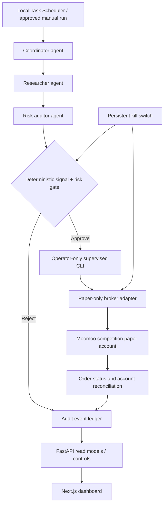

# Architecture — MooTrade

**Status:** partially implemented (19 November 2026). The account lock, deterministic policy gate, mock broker, ledger, read-only adapter, deterministic research/dry-run pipeline and a three-agent read-only Qoder Cloud Agent workflow exist. A genuine historical run completed with real session IDs, and local Windows Task Scheduler entries run the read-only schedule, the AUTO_PAPER execution phase and the daily risk monitor unattended with catch-up and durable idempotent state. AUTO_PAPER was activated by explicit owner authorization on 18 November 2026 (16:03Z) via a durable append-only pin bound to the competition-account fingerprint, `spy-directional`, the `SPY`/`SH` allowlist, `risk-v1` and the standard limits. The owner approved the risk-v2 cutover on 18 November 2026 and the **risk-v2 activation is now recorded** (23:58Z: SPY/UPRO/SH/SPXU, 20%/150% signed-effective exposure, 3x leverage, 2% drawdown); the risk-v1 row is retained append-only. During the acceptance phase `TRADING_MODE=SUPERVISED_PAPER` and `ORDER_WRITES_ENABLED=false`, so autonomous submission is gated until the supervised UPRO/SPXU acceptance orders complete; restoring `AUTO_PAPER` then continues autonomous risk-v2 trading without individual order approvals. The first autonomous strategy trade has not occurred yet. A read-only six-section Next.js dashboard and its typed FastAPI read models now exist, with policy-versioned limits and signed effective-exposure views. The separate execution OAuth client was authorized on 18 November 2026 with `quote:read trade:read trade:write`; account-exclusive write scope remains unverified. A guarded simulated-order transport and paper-broker facade are composed by an operator-only supervised CLI boundary; writes are scoped to the supervised executor and require both explicit CLI flags, an exact durable approval and every preflight check. `ORDER_WRITES_ENABLED=false`.

## One-sentence system design

Qoder Cloud Agents review a deterministic SPY signal and its proposal; an independent Python policy engine validates it; a separately supervised paper-only broker adapter is the only possible order path; an append-only event store and reconciler supply a read-only dashboard.

## Logical flow



**Non-negotiable boundary:** agents may propose and explain, but only the deterministic gate and paper-only broker adapter authorise order submission. The diagram shows the logical flow, not a guarantee that Qoder exposes every desired execution interface.

**Implemented research path (dry-run only):** `backend/app/research/` computes the fixed SPY directional signal from completed daily bars, determines a tier-based target signed exposure fraction, selects one of SPY, UPRO, SH, SPXU or CASH, accounts for the current broker holding and builds a typed `TradeProposal`. Signal arithmetic, tier calculation, selection, sizing, HOLD/exit/reversal/resize/duration state and sizing are deterministic. It does not call `TradingService`, the mock broker or any Moomoo order tool. The research and supervised-execution gates carry the four-symbol universe with per-symbol leverage metadata. The pinned activation selects the policy: the recorded pin is `risk-v2` (18 November 2026 23:58Z, owner cutover) with the tier model, a 20% floor, a 150% signed-effective ceiling and 3x maximum leverage; the superseded `risk-v1` row (SPY/SH only, UPRO/SPXU fail closed at `R015`) is retained append-only. QQQ remains outside the strategy universe and is preserved for historical diagnostic reconciliation only.

**Implemented supervised boundary (operator-only):** `backend/app/supervised.py` composes the existing execution OAuth, read-only REST broker, quote feed, `MoomooPaperBroker`, `RiskGate`, ledger and `TradingService`. The only write-capable entry point is `moomoo-supervised-execute`, which requires `TRADING_MODE=SUPERVISED_PAPER` or `AUTO_PAPER` (READ_ONLY or any unknown value fails closed), plus both `--enable-order-writes` and an exact `--confirm-client-order-key`, a durable approval bound to that proposal, a fresh regular-session quote, a reconciled competition account, a clean kill switch and every gate rule. Submission happens once; ambiguous outcomes become `UNKNOWN` with no retry; fills are accepted only from read-only reconciliation. Qoder and MCP agent sessions have no path to these commands.

**Implemented trading modes and AUTO_PAPER activation:** `backend/app/trading_mode.py` resolves `TRADING_MODE` (`READ_ONLY` default, `SUPERVISED_PAPER`, `AUTO_PAPER`). `moomoo-activate-auto-paper` records an append-only activation pin in the ledger that binds the exact competition-account fingerprint, `spy-directional`, the allowed symbols and a versioned risk policy. Two rows exist: the first pin is `SPY`/`SH` under `risk-v1` (5% position fraction, 10% single / 30% gross, no leverage; 18 November 2026 16:03Z), and the recorded pin is `risk-v2` (SPY/UPRO/SH/SPXU, 20% floor, 150% signed-effective ceiling, 3x leverage, 2% drawdown; 18 November 2026 23:58Z, owner-approved cutover). The command never submits an order and refuses unless the environment is already in `AUTO_PAPER` with writes enabled. Autonomous runs additionally re-check the env mode, write flag, pin match, kill switch and a fresh RiskGate decision at every run. During the acceptance phase `.env` holds `TRADING_MODE=SUPERVISED_PAPER` and `ORDER_WRITES_ENABLED=false`, gating autonomous submission until the supervised UPRO/SPXU acceptance orders complete; restoring `TRADING_MODE=AUTO_PAPER` in `.env` (leaving `ORDER_WRITES_ENABLED=false` — the auto-paper scheduler scopes writes `true` in-process for the executor only, while the read-only scheduler, risk monitor and dashboard API refuse an enabled flag) then resumes trading under the recorded risk-v2 pin.

**Implemented AUTO_PAPER execution phase:** `backend/scripts/auto_paper_run.py` is the only unattended order path. It runs at the start of the next US regular session, revalidates the bars ending at the prior completed session, pins the read-only scheduler's same-session COMPLETED three-agent artifact (mode, strategy and signal must match the deterministic recomputation), recomputes `screen` + `decide` against a fresh broker snapshot, and for BUY/SELL proposals takes a fresh regular-session quote through the existing `TradingService` gate with `ORDER_WRITES_ENABLED=true` scoped to the invocation. HOLD/CASH are recorded without submission; duplicates, `UNKNOWN` submissions, an engaged kill switch, a missing pin, a stale account and a closed market all abort before any write. `backend/scripts/schedule_auto_paper.py` runs the phase only inside the 09:35-10:30 ET window via Windows Task Scheduler triggers at 13:35Z/14:35Z, using the evening decision artifacts in `evidence/qoder/` and bars in `evidence/current-market/<session>/`; missed windows are not backfilled and later triggers do not retry an abstained session.

**Implemented daily risk monitor (read-only):** `backend/scripts/risk_monitor.py` runs in three ET windows (reconcile `09:45-10:30`, midday `12:00-13:00`, pre-close `15:45-16:00`) from one Task Scheduler task with six dual-DST triggers. It is strictly read-only: it builds its supervised-execution stack with `order_writes_enabled=False` and refuses to run when the environment has `ORDER_WRITES_ENABLED=true` or a trade-write token. It reconciles ambiguous submissions, checks daily drawdown against the pinned activation, computes signed-effective (risk-v2) or single/gross (risk-v1) exposure, flags 3x holding duration and leftover open orders, and appends `RISK_BREACH` audit events. The persistent kill switch engages only on a daily-drawdown breach or ambiguous submissions still unresolved at pre-close; exposure/duration/open-order breaches are reported only, because the deterministic reduction rules at the next execution window handle them and an engaged kill switch would block those exits. The operator can also engage/release the kill switch directly via `moomoo-kill-switch` (confirmation required, audit events recorded).

**Implemented read-only Qoder workflow:** `backend/scripts/qoder_readonly_run.py` coordinates three Cloud Agents: a coordinator that validates the run boundary and closes the report, a researcher that calls `research_market`, and an independent auditor that reviews the result and calls `evaluate_proposal` when a proposal exists. The researcher reviews runner-pinned SPY bars and, in current mode, sanitized read-only account and quote inputs; agents cannot alter the deterministic signal or write market data. Custom tools are executed in local Python by `backend/app/qoder_tools.py`, whose handler allowlist, strict input schemas, pinned run state and proposal-to-research binding prevent arbitrary commands or modified proposals. Agents receive no Moomoo MCP tools, Vault bindings, repository resources or order authority.

## Services and responsibilities

| Component | Owns | May perform broker writes? |
|---|---|---|
| Account lock | Exact simulated-account resolution by masked id + SHA-256 fingerprint; rejects live, other-paper and market-only matches | No |
| Coordinator agent | Validates the run boundary and closes the report from sanitized deterministic artifacts | No |
| Researcher agent | Reviews the SPY trend, 10-session return, volatility, target ETF or CASH and data-quality flags | No |
| Risk auditor agent | Independent challenge of thesis, stale data, concentration, leverage and downside | No |
| Policy gate (Python) | Instrument allowlist, sizes, cash, exposure, drawdown, position count, first-order approval, circuit breaker, kill switch; versioned (`risk-v2` recorded pin, `risk-v1` row retained) | Authorises only; no direct writes |
| Executor + broker adapter | Paper account route, idempotency, order submission and status checks | Yes, after validation |
| Reconciler | Broker/ledger comparison, uncertain states, sync health | Read-only; cancellation only if separately authorised |
| Risk monitor (scheduled) | Read-only windowed checks, breach events, kill-switch engagement on drawdown/unresolved-ambiguous only | No |
| Event ledger | Immutable decision/order/fill/risk event history | No |
| FastAPI | Read-only dashboard models; no trading control route | No |
| Next.js | Read-only human observation; PAPER and provenance labels | No direct MCP or credential access |

## Trust boundaries

1. **Market and agent text:** untrusted. Research, news and model output cannot modify permissions, instruments, limits, event direction or code.
2. **Cloud agent environment:** uses least-privilege connector scopes. No live accounts. Store secrets in Qoder-supported secure storage, not agent prompts.
3. **Policy engine:** deterministic Python with versioned rules; accepts validated typed proposals only.
4. **Broker adapter:** owns the only order-write path. Must match the competition account identifier/fingerprint, not merely a flag passed by an LLM.
5. **Dashboard:** displays server-trusted state; no exposed OAuth tokens. Control endpoints require authentication if reachable beyond localhost.
6. **MCP tool surface:** the Qoder Cloud Agent `moomoo-mcp-readonly-test` v4 uses the documented `mcp_toolset` policy to set `always_deny` on all ten order-writing tools and exposes only the built-in `Read` tool; `Bash`, `WebFetch`, `WebSearch`, `Write` and `Edit` are absent. A fresh v4 session with vault `vault_00vqvi7wl0xs2mgffyo8` attached registered the Moomoo read tools and returned the competition account state; without the vault, MCP initialization returned HTTP 401. No order tool registered, so no order could be executed or contact an order endpoint. Raw Moomoo tool results contain full account ids, so cloud session event logs must not be exported. The local interactive Qoder session still exposes the full Moomoo tool set, including order tools; it must not be used as the execution boundary. The read-only adapter uses only four simulated-account read tools and has no write method. `ORDER_WRITES_ENABLED=false`; see `docs/integrations.md`.

## Minimum contract examples

Agent proposal (illustrative shape, not a Moomoo API contract):

```json
{
  "schema_version": "1",
  "run_id": "example-run-001",
  "strategy_version": "spy-directional",
  "decision_time_utc": "2026-11-18T21:00:00Z",
  "data_as_of_utc": "2026-11-17T21:00:00Z",
  "symbol": "SH",
  "action": "BUY",
  "requested_quantity": 147,
  "thesis": "SPY 10-session return and trend are bearish; target inverse exposure through SH",
  "invalidation": "Exit at the next open after a neutral, opposite or volatility-ceiling signal",
  "evidence_ids": ["bar:SPY:2026-11-17", "bar:SH:20261117"]
}
```

Policy outcome fields: `proposal_id`, `policy_version`, `decision` (`APPROVE`/`REJECT`), `reasons[]`, `approved_quantity`, `account_snapshot_id`, `expires_at_utc`, `audit_event_id`. A policy approval is short-lived and bound to a specific proposal/account snapshot. A changed account snapshot requires rechecking.

Order fields: `client_order_key`, `proposal_id`, `paper_account_id` (stored securely/redacted in exports), `broker_order_id`, `status`, `submitted_at`, `last_broker_sync`, `fills[]`. Never use a model-generated order ID as authoritative.

## Order lifecycle and idempotency

```text
PROPOSED
  -> POLICY_REJECTED
  -> POLICY_APPROVED -> SUBMITTING -> ACKNOWLEDGED
                                          -> PARTIALLY_FILLED -> FILLED
                                          -> CANCELLED / REJECTED
                                          -> UNKNOWN (timeout/ambiguous result)
```

- Persist unique `client_order_key` **before** write. If provider supports client order IDs, use them; otherwise use a persistent local de-duplication guard and reconcile by broker order history.
- The first paper order also requires a durable owner approval bound to that key (`R014`); the approval command never submits an order.
- Enforce explicit status transitions in the ledger (`SUBMITTING -> ACKNOWLEDGED/PARTIALLY_FILLED/FILLED/CANCELLED/REJECTED/UNKNOWN`); terminal states cannot move backwards.
- For `UNKNOWN`, stop fresh submissions, query status and account state; never blindly replay a write.
- Broker status wins over local assumption; ledger preserves all intermediate states.
- Kill switch blocks new writes and persists across restarts. Cancelling open paper orders is a separate, explicitly logged action. It does not necessarily liquidate holdings.

## Event store

Append-only `events`: `event_id`, `occurred_at_utc`, `run_id`, `event_type`, `source`, `payload_redacted_json`, `correlation_id`, `schema_version`.

Suggested event types: `RESEARCH_COMPLETED`, `PROPOSAL_CREATED`, `NO_TRADE`, `POLICY_APPROVED`, `POLICY_REJECTED`, `ORDER_SUBMISSION_STARTED`, `ORDER_ACKNOWLEDGED`, `ORDER_UNKNOWN`, `FILL_CONFIRMED`, `RECONCILIATION_OK`, `RECONCILIATION_MISMATCH`, `KILL_SWITCH_ACTIVATED`, `AGENT_ERROR`.

Materialised dashboard views may be rebuilt from events and verified broker snapshots. Do not mutate event records when correcting an earlier belief; append a correction/observation.

## Implemented dashboard read API

`backend/app/dashboard/api.py` exposes only `GET /api/v1/{health,overview,portfolio,risk,agents,analytics,audit}`. The app refuses to start if `ORDER_WRITES_ENABLED=true` (the production `.env` keeps it `false` in every mode, so the refusal is a tripwire, never the operating state); non-GET methods return `405`; non-loopback access requires a bearer token. There is no order, cancellation or control route. The health and safety payloads report the recorded `trading_mode` and the effective order-write state (environment flag or AUTO_PAPER activation pin). The risk payload reports the pinned activation's `policy_version`, its versioned limits (`risk-v1` single/gross caps or `risk-v2` effective-exposure floor/ceiling/leverage), the allowlisted symbols and broker-derived gross/signed-effective exposure. See `docs/dashboard.md`.

## Earlier backend API sketch (superseded, kept for rationale)

| Endpoint | Method | Returns / action |
|---|---|---|
| `/api/health` | GET | health, sync and connector state |
| `/api/overview` | GET | equity, cash, drawdown, stale status, risk mode |
| `/api/agents/runs` | GET | Qoder run summaries and evidence pointers |
| `/api/decisions` | GET | proposals, risk decisions and provenance |
| `/api/orders` | GET | broker-verified orders and fills |
| `/api/positions` | GET | most recent broker-verified holdings |
| `/api/risk` | GET | limits, actual exposures, circuit breaker, kill state |
| `/api/performance` | GET | actual paper equity and benchmark series |
| `/api/control/pause` | POST | authenticated halt of *new* submissions |
| `/api/control/resume` | POST | authenticated, preflight-checked resume |
| `/api/control/kill` | POST | authenticated persistent hard stop |

## Runtime / deployment

- Development: local FastAPI and Next.js; mocked broker available for tests; real cloud agent runs use Qoder managed runtime.
- Production demo: hosted dashboard/backend **only if needed**; database must have a durable volume and recover after restart. Do not place a local SQLite DB on ephemeral hosting.
- Only the backend/restricted Qoder connector has secrets. Browser receives sanitised, least-privilege data.
- Set all event timestamps in UTC; show Singapore time in UI. US market-day handling must be timezone aware.

## Technology decision

The dashboard uses **Next.js + TypeScript**, adapted from the MIT-licensed Shadcn Fintech template, over the Python 3.11+ / FastAPI / Pydantic backend. The template's licence, provenance and dependencies were reviewed; attribution is preserved in `frontend/ATTRIBUTION.md`.

## Failure modes to test before enabling order writes

Stale quote; incorrect account; account desync; invalid instrument; insufficient funds; duplicated run; ambiguous broker response; partial fill; API rate limit; MCP OAuth expiry; malformed provider JSON; secret expiry; process restart; drawdown threshold; kill-switch persistence; frontend showing stale state; direct MCP order-tool bypass.
