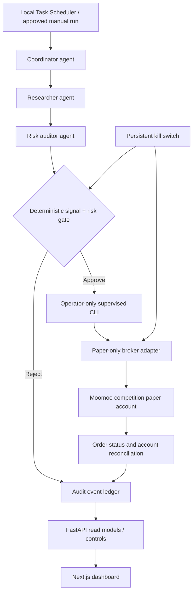

# Architecture — MooTrade

**Status:** partially implemented (20 November 2026). The account lock, deterministic gate, mock broker, ledger, read-only REST adapter, deterministic research pipeline, three-agent read-only Qoder workflow and six-page dashboard exist. The current mandate is **risk-v3 only (SPY/SH, 10%–40% allocations, CASH when no valid trade), with exact-proposal owner approval for EVERY supervised BUY and SELL**. `TRADING_MODE=SUPERVISED_PAPER` and `ORDER_WRITES_ENABLED=false` remain in force. UPRO/SPXU were removed from the universe on 20 November 2026 and are rejected by default-deny symbol validation; their historical records are preserved. This is code preparation, not new activation, permission or an order; Read-only SPY/SH MARKET capacity was verified on 19 November (112/2,476 cash-buy shares); this is not guaranteed order acceptance. Historical activation pins and dormant AUTO_PAPER code do not authorise unattended trading. Separate explicit approval is required before any future autonomy. The only broker-confirmed fills are the separately approved QQQ diagnostic BUY/SELL, both reconciled on 18 November; no strategy order has been submitted. Execution OAuth was authorised on 18 November with `quote:read trade:read trade:write`, but account-exclusive write scope remains unverified.

## One-sentence system design

Qoder Cloud Agents review a deterministic SPY signal and its proposal; an independent Python policy engine validates it; a separately supervised paper-only broker adapter is the only possible order path; an append-only event store and reconciler supply a read-only dashboard.

## Logical flow



**Non-negotiable boundary:** agents may propose and explain, never authorise. EVERY supervised BUY/SELL needs explicit owner approval for its exact proposal/key, deterministic gate eligibility and the paper-only adapter. A passing gate is not owner approval. The diagram shows logical flow, not a guarantee of platform interfaces.

**Implemented research path (dry-run only):** `backend/app/research/` computes the SPY signal from completed daily bars, determines a tiered signed target (`0%` CASH or `10%`/`25%`/`40%` magnitude), selects SPY, SH or CASH, and builds a typed `TradeProposal`. Signal arithmetic, selection, sizing and HOLD/exit/reversal/resize/duration state are deterministic. Research has no broker-write path. Risk-v2.1 is the only active policy, not selected by an old activation row. UPRO/SPXU are outside the universe and rejected by default-deny validation. The 40% signed-effective ceiling, declared-target tolerance of ±5 percentage points, 2% drawdown brake, US$5 cash buffer and freshness checks (quote 300s, account 60s) remain. RiskGate permits at most one position, matching the strategy's one directional position. QQQ is historical diagnostic reconciliation only.

**Prepared supervised boundary (operator-only):** `backend/app/supervised.py` composes execution OAuth, read-only REST broker, quote feed, `MoomooPaperBroker`, RiskGate, ledger and `TradingService`. The current authorised workflow uses `SUPERVISED_PAPER`, both `--enable-order-writes` and exact `--confirm-client-order-key`, durable approval for EVERY BUY/SELL proposal/key, a fresh regular-session quote, reconciled competition account, clean kill switch and every applicable rule. The existing `moomoo-supervised-preview` and `moomoo-supervised-execute` arguments gain `--proposal-file`: load the exact research proposal, preserving timestamps, evidence and target, and reject mismatches with any required CLI field. Preview reports per-rule states and current/post-order signed-effective exposure without submitting. Submission happens once; ambiguous outcomes become `UNKNOWN` with no retry; fills require read-only reconciliation. Qoder/MCP agents have no path to these commands. Current verification results and the genuine submission-disabled preview are recorded in `docs/evidence.md`.

**HISTORICAL activation records, not current authority:** two append-only pins remain: `SPY`/`SH` under `risk-v1` (5% position fraction, 10% single / 30% gross, no leverage; 18 November 2026 16:03Z), and `risk-v2` (SPY/UPRO/SH/SPXU, 20% floor, 150% signed-effective ceiling, 3x leverage, 2% drawdown; 18 November 2026 23:58Z). Both were superseded by the 20 November 2026 risk-v3 cutover (SPY/SH only, 10%–40% or CASH, one position, 1x). Do not reinterpret, delete or reactivate the retired pins. `backend/app/trading_mode.py` retains mode/activation machinery for audit and separately authorised future work, but an old pin never substitutes for the current per-order approval mandate.

**AUTO_PAPER schedule machinery (Mode A active, Mode B dormant):** `backend/scripts/auto_paper_run.py` and `schedule_auto_paper.py` run from `MooTrade Auto Paper Scheduler` (09:35–10:30 ET, 13:35Z/14:35Z triggers, pinned completed decision artifact, fresh broker checks, no missed-window backfill or ambiguous retry). The wrapper sets `TRADING_MODE=SUPERVISED_PAPER`, so the morning phase recomputes and records the deterministic risk-v3 decision (`AUTO_PAPER_DECISION` event) and **never submits**; a BUY/SELL outcome awaits `moomoo-supervised-execute` after exact owner approval. Order writes are scoped to the executor subprocess only in `AUTO_PAPER` mode, which additionally requires a durable activation pin (optionally time-limited with `--expires-at`; the executor refuses after expiry). No autonomous scope is authorised now; a future autonomous scope requires separate explicit owner approval — the shared execution service requires an exact approval for every order, without an opt-out.

**Implemented daily risk monitor (read-only):** `backend/scripts/risk_monitor.py` runs in three ET windows (reconcile `09:45-10:30`, midday `12:00-13:00`, pre-close `15:45-16:00`) from one Task Scheduler task with six dual-DST triggers. It builds its stack with `order_writes_enabled=False` and refuses an enabled environment flag or a trade-write token. It reconciles ambiguous submissions, checks the 2% daily-drawdown brake and signed-effective risk-v3 exposure, flags open orders and appends `RISK_BREACH` events; it skips symbols outside the risk-v3 universe (e.g. historical UPRO/SPXU holdings) instead of crashing. The persistent kill switch engages on daily drawdown or unresolved ambiguous submissions at pre-close; exposure/duration/open-order breaches are reported only. Any resulting reduction or exit still needs exact-proposal owner approval; the monitor never submits it. `moomoo-kill-switch` also permits confirmed, audited operator engagement/release.

**Implemented read-only Qoder workflow:** `backend/scripts/qoder_readonly_run.py` coordinates three Cloud Agents: a coordinator that validates the run boundary and closes the report, a researcher that calls `research_market`, and an independent auditor that reviews the result and calls `evaluate_proposal` when a proposal exists. The researcher reviews runner-pinned SPY/SH bars and, in current mode, sanitized read-only account and quote inputs; agents cannot alter the deterministic signal or write market data. Custom tools are executed in local Python by `backend/app/qoder_tools.py`, whose handler allowlist, strict input schemas, pinned run state and proposal-to-research binding prevent arbitrary commands or modified proposals. Agents receive no Moomoo MCP tools, Vault bindings, repository resources or order authority.

## Services and responsibilities

| Component | Owns | May perform broker writes? |
|---|---|---|
| Account lock | Exact simulated-account resolution by masked id + SHA-256 fingerprint; rejects live, other-paper and market-only matches | No |
| Coordinator agent | Validates the run boundary and closes the report from sanitized deterministic artifacts | No |
| Researcher agent | Reviews the SPY trend, 10-session return, volatility, target ETF or CASH and data-quality flags | No |
| Risk auditor agent | Independent challenge of thesis, stale data, concentration, leverage and downside | No |
| Policy gate (Python) | Risk-v2.1 only: SPY/SH allowlist, 10%–40% sizes or CASH, cash, signed exposure, drawdown, one-position limit, approval for every supervised order, circuit breaker and kill switch | Eligibility only; owner approval also required; no direct writes |
| Executor + broker adapter | Paper account route, idempotency, order submission and status checks | Yes, after validation |
| Reconciler | Broker/ledger comparison, uncertain states, sync health | Read-only; cancellation only if separately authorised |
| Risk monitor (scheduled) | Read-only windowed checks, breach events, kill-switch engagement on drawdown/unresolved-ambiguous only | No |
| Event ledger | Immutable decision/order/fill/risk event history | No |
| FastAPI | Read-only dashboard models; no trading control route | No |
| Next.js | Read-only human observation; PAPER and provenance labels | No direct MCP or credential access |

## Trust boundaries

1. **Market and agent text:** untrusted. Research, news and model output cannot modify permissions, instruments, limits, event direction or code.
2. **Cloud agent environment:** uses least-privilege connector scopes. No live accounts. Store secrets in Qoder-supported secure storage, not agent prompts.
3. **Policy engine:** deterministic Python with versioned rules; accepts validated typed proposals only.
4. **Broker adapter:** owns the only order-write path. Must match the competition account identifier/fingerprint, not merely a flag passed by an LLM.
5. **Dashboard:** displays server-trusted state; no exposed OAuth tokens. Control endpoints require authentication if reachable beyond localhost.
6. **MCP tool surface:** the Qoder Cloud Agent `moomoo-mcp-readonly-test` v4 uses the documented `mcp_toolset` policy to set `always_deny` on all ten order-writing tools and exposes only the built-in `Read` tool; `Bash`, `WebFetch`, `WebSearch`, `Write` and `Edit` are absent. A fresh v4 session with vault `vault_00vqvi7wl0xs2mgffyo8` attached registered the Moomoo read tools and returned the competition account state; without the vault, MCP initialization returned HTTP 401. No order tool registered, so no order could be executed or contact an order endpoint. Raw Moomoo tool results contain full account ids, so cloud session event logs must not be exported. The local interactive Qoder session still exposes the full Moomoo tool set, including order tools; it must not be used as the execution boundary. The read-only adapter uses only four simulated-account read tools and has no write method. `ORDER_WRITES_ENABLED=false`; see `docs/integrations.md`.

## Minimum contract examples

HISTORICAL proposal shape (retired-size example, not an executable v2 proposal or a Moomoo API contract):

```json
{
  "schema_version": "1",
  "run_id": "example-run-001",
  "strategy_version": "spy-directional",
  "decision_time_utc": "2026-11-18T21:00:00Z",
  "data_as_of_utc": "2026-11-17T21:00:00Z",
  "symbol": "SH",
  "action": "BUY",
  "requested_quantity": 147,
  "thesis": "SPY 10-session return and trend are bearish; target inverse exposure through SH",
  "invalidation": "Exit at the next open after a neutral, opposite or volatility-ceiling signal",
  "evidence_ids": ["bar:SPY:2026-11-17", "bar:SH:20261117"]
}
```

Policy outcome fields: `proposal_id`, `policy_version`, `decision` (`APPROVE`/`REJECT`), `reasons[]`, `approved_quantity`, `account_snapshot_id`, `expires_at_utc`, `audit_event_id`. The risk decision has a 30-second TTL and is bound to the exact proposal/account snapshot; a changed snapshot requires rechecking. This expiry does not expire or replace the separate durable owner approval.

Order fields: `client_order_key`, `proposal_id`, `paper_account_id` (stored securely/redacted in exports), `broker_order_id`, `status`, `submitted_at`, `last_broker_sync`, `fills[]`. Never use a model-generated order ID as authoritative.

## Order lifecycle and idempotency

```text
PROPOSED
  -> POLICY_REJECTED
  -> POLICY_APPROVED -> SUBMITTING -> ACKNOWLEDGED
                                          -> PARTIALLY_FILLED -> FILLED
                                          -> CANCELLED / REJECTED
                                          -> UNKNOWN (timeout/ambiguous result)
```

- Persist unique `client_order_key` **before** write. If provider supports client order IDs, use them; otherwise use a persistent local de-duplication guard and reconcile by broker order history.
- EVERY supervised BUY and SELL requires durable owner approval for the exact proposal/key (`R014`), even after prior fills. `approve-first-order` is the retained historical CLI name, used for each order; it never submits. The owner approval is durable; the separate risk decision expires after 30 seconds and must be refreshed on expiry or changed account state. `R014` is mode-aware: in `AUTO_PAPER` only, a valid unexpired risk-v3 activation pin (account fingerprint, strategy version, symbol allowlist and pinned limits bound; recorded durably with an expiry) replaces per-order approval. The pin is re-validated deterministically on every autonomous run and never applies on the supervised gate.
- Enforce explicit status transitions in the ledger (`SUBMITTING -> ACKNOWLEDGED/PARTIALLY_FILLED/FILLED/CANCELLED/REJECTED/UNKNOWN`); terminal states cannot move backwards.
- For `UNKNOWN`, stop fresh submissions, query status and account state; never blindly replay a write.
- Broker status wins over local assumption; ledger preserves all intermediate states.
- Kill switch blocks new writes and persists across restarts. Cancelling open paper orders is a separate, explicitly logged action. It does not necessarily liquidate holdings.

## Event store

Append-only `events`: `event_id`, `occurred_at_utc`, `run_id`, `event_type`, `source`, `payload_redacted_json`, `correlation_id`, `schema_version`.

Suggested event types: `RESEARCH_COMPLETED`, `PROPOSAL_CREATED`, `NO_TRADE`, `POLICY_APPROVED`, `POLICY_REJECTED`, `ORDER_SUBMISSION_STARTED`, `ORDER_ACKNOWLEDGED`, `ORDER_UNKNOWN`, `FILL_CONFIRMED`, `RECONCILIATION_OK`, `RECONCILIATION_MISMATCH`, `KILL_SWITCH_ACTIVATED`, `AGENT_ERROR`.

Materialised dashboard views may be rebuilt from events and verified broker snapshots. Do not mutate event records when correcting an earlier belief; append a correction/observation.

## Implemented dashboard read API

`backend/app/dashboard/api.py` exposes only `GET /api/v1/{health,overview,portfolio,risk,agents,analytics,audit}`. It refuses `ORDER_WRITES_ENABLED=true`; non-GET methods return `405`; non-loopback access requires a bearer token. There is no order, cancellation or control route. Health/safety views must report the current `SUPERVISED_PAPER` mode and disabled runtime writes without treating a historical pin as current authority. Risk-v2.1 is the sole active policy; show its limits, SPY/SH execution allowlist and broker-derived gross/signed-effective exposure, not selectable retired caps. Historical artifacts keep their original policy/provenance. See `docs/dashboard.md`.

## Earlier backend API sketch (superseded, kept for rationale)

| Endpoint | Method | Returns / action |
|---|---|---|
| `/api/health` | GET | health, sync and connector state |
| `/api/overview` | GET | equity, cash, drawdown, stale status, risk mode |
| `/api/agents/runs` | GET | Qoder run summaries and evidence pointers |
| `/api/decisions` | GET | proposals, risk decisions and provenance |
| `/api/orders` | GET | broker-verified orders and fills |
| `/api/positions` | GET | most recent broker-verified holdings |
| `/api/risk` | GET | limits, actual exposures, circuit breaker, kill state |
| `/api/performance` | GET | actual paper equity and benchmark series |
| `/api/control/pause` | POST | authenticated halt of *new* submissions |
| `/api/control/resume` | POST | authenticated, preflight-checked resume |
| `/api/control/kill` | POST | authenticated persistent hard stop |

## Runtime / deployment

- Development: local FastAPI and Next.js; mocked broker available for tests; real cloud agent runs use Qoder managed runtime.
- Production demo: hosted dashboard/backend **only if needed**; database must have a durable volume and recover after restart. Do not place a local SQLite DB on ephemeral hosting.
- Only the backend/restricted Qoder connector has secrets. Browser receives sanitised, least-privilege data.
- Set all event timestamps in UTC; show Singapore time in UI. US market-day handling must be timezone aware.

## Failure modes to test before enabling order writes

Stale quote; incorrect account; account desync; invalid instrument; insufficient funds; duplicated run; ambiguous broker response; partial fill; API rate limit; MCP OAuth expiry; malformed provider JSON; secret expiry; process restart; drawdown threshold; kill-switch persistence; frontend showing stale state; direct MCP order-tool bypass.
